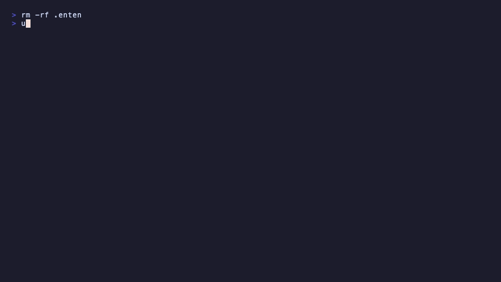
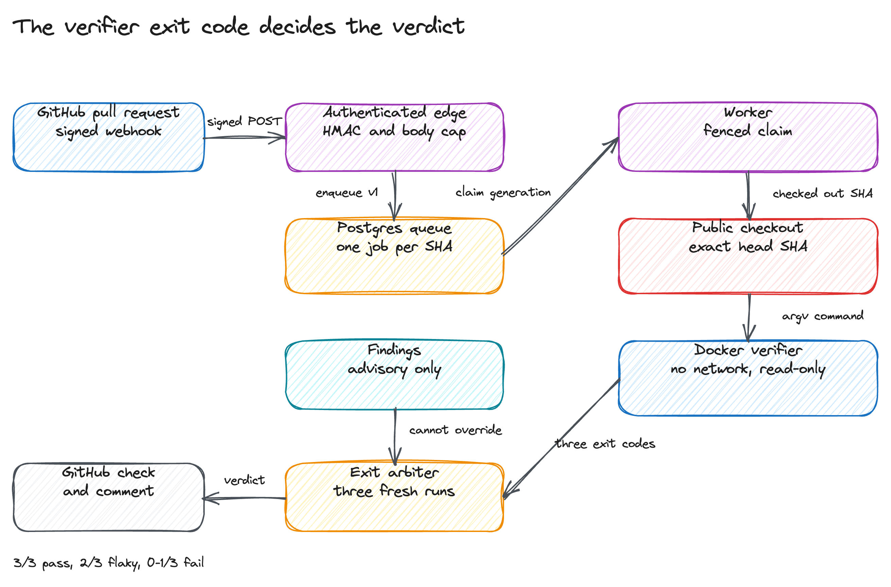

# enten

enten reviews GitHub pull requests in a Docker sandbox and reports a
verdict derived from one command's exit code. It runs as a self-hosted GitHub
App for a team, or as a CLI on a local checkout.

The worker fetches the exact pull request head, runs the operator-selected
verification command three times in a networkless container, and maps the exit
codes to `pass`, `flaky`, `fail`, or `error`. Findings can describe a defect;
they cannot change that verdict. The GitHub App reads pull requests and writes
checks and comments. It cannot write repository contents.

## Quickstart

Requirements: Python 3.11 or newer, [uv](https://docs.astral.sh/uv/), Node 22,
and pnpm. Docker is only needed for the hosted verifier path.

```bash
git clone https://github.com/Meillaya/enten.git
cd enten
make install
uv run enten review --repo . --verify-command "python -m compileall -q ."
```

The command prints one JSON object and stores the run in `.enten/reviews.json`:

```json
{"replayed": false, "review_id": "e94039eb27fd917e1f7a3236a04e2f59", "stage": "completed", "verdict": "pass"}
```

The local path posts nothing to GitHub. `--verify-command` takes an argv string
and runs it without a shell.

## CLI demo

The recording runs a local review, the eval harness, the cost report, and the
reconciliation command help. The source is
[docs/demo.tape](docs/demo.tape); render it with VHS 0.11.0. VHS 0.12.0
currently drops encoded output.



## Hosted review



A signed webhook reaches the TypeScript edge, which validates the HMAC and
enqueues a versioned job in Postgres. The Python worker claims the job with a
lease generation, fetches the exact head SHA from the repository, and
starts the verifier container. The container runs with a read-only root
filesystem and no network. All Linux capabilities are dropped. It runs as a
non-root user and bounds CPU, memory, PID count, and time.

A check and one pull request comment go out through a durable effect ledger.
The worker records an attempt before each GitHub write and stops on an
ambiguous result, so a timeout does not become a duplicate comment. If the
check exists but its response was lost, `enten reconcile` adopts the observed
check and requeues the run; the missing comment is posted once.

The worker uses the bounded local generator by default. Set
`REVIEW_GENERATOR=llm` and configure one provider to let a model propose
findings: `openai-compat` for OpenAI, OpenRouter, and LM Studio, `anthropic`
for the native Messages API, or `ollama` for local models. The verifier exit
code still decides the verdict.

Set `REVIEW_PROBES=on` to publish only findings that a generated pytest probe
reproduces in the sandbox. `shadow` measures probes without publishing. The
same setting applies to private repositories. The verifier image must contain
pytest and the project dependencies.

## Deployment

Compose runs Postgres, migrations, the edge, and the worker on one Docker host.
The worker needs `/var/run/docker.sock`, which is root-equivalent host
authority, so use a dedicated host. The topology, environment variables, and
known limits are in [docs/deploy.md](docs/deploy.md). The full worker setup and
live pull request test are in
[docs/worker-deployment.md](docs/worker-deployment.md).

The web tier and migrations also run on Railway from `.railway/railway.ts`.
Apply it with `railway config apply` on CLI 5.42.1 or newer. Railway does not
provide a Docker socket, so the worker stays on a self-hosted host. The scratch
deployment tested on 2026-10-31 served `/health` and `/ready`, ran the
migrations, and accepted a signed webhook into Postgres.

## Checks

```bash
make check
```

That target runs Ruff, the TypeScript compiler and build, Python and Vitest
coverage gates, the eval harness, the permission check, a gitleaks scan, and a
production dependency audit.

## Documentation

- [Architecture and trust boundaries](docs/architecture.md)
- [Deployment and limitations](docs/deploy.md)
- [Worker deployment and live test](docs/worker-deployment.md)
- [Operations runbook](docs/runbook.md)
- [GitHub App permissions](docs/permissions.md)
- [Verifier demo contracts](docs/demo-repo.md)
- [Audit and fixes](docs/audit.md)

## License

MIT. See [LICENSE](LICENSE).
